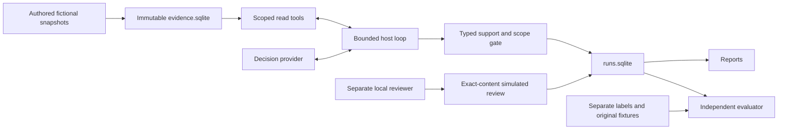

# Architecture and tradeoffs

Python 3.11 standard library and bundled SQLite keep the offline workflow standalone. One host owns a finite actor loop, typed support gate and transactional workflow database. The provider receives copied conversation/catalog data and can request only one allowed tool at a time. No general file, SQL, URL, evaluator, review or containment tool exists.

## Evidence and tool boundaries

The initializer validates fictional subjects, versions, record types, a maximum seven-day window, and at most 500 records. It creates evidence once and rejects differing content on reuse. EvidenceStore opens SQLite with `mode=ro` and `query_only`, checks snapshot hash and indexed records, and owns fixed parameterized query text. Authentication/resource records outside the window or ingested after the cutoff are omitted.

Identity, telemetry, device, exact-IP network, travel and event-search tools are finite. Device/IP lookups require an alert or observed reference; session filters require an observed authentication session. Network/travel validity must cover the entire case interval. Event search permits only case-bounded time/IP/session filters, with 50 rows per page and at most two pages per exact query. Cursors are issued by the host, bound to query and snapshot, and restored from persisted observations. Unknown, changed and repeated cursors fail. An incomplete second page remains partial.

An empty event result does not imply complete coverage. Benign disposition requires completed unfiltered authentication/resource chains plus complete coverage of both intervals, exact approved network or travel, managed device, satisfied MFA, and no unresolved adverse record or other successful device/IP. Escalation requires cited distinct MFA denials before a supported success, or sensitive same-session activity with an unmanaged device. Proposed targets must be that supported successful session.

## Durable host loop

Run identity binds case/snapshot, operator request ID, provider configuration, policy/prompt/tool protocol and budget. Schema 2 stores original creation/expiry, turns used, corrections used and cancellation. M1 schema-1 output is preserved and explicitly refused for writing; use a fresh schema-2 output directory.

Before each provider call, `BEGIN IMMEDIATE` commits its turn reservation and `REQUEST_STARTED` attempt. Recording accepted final output, proposal, disposition and completion is one transaction. Component fault injection checks rollback of that transaction. SQLite or OS failure aborts the current CLI operation; a later explicit resume restores committed observations, marks interrupted reservations and never resets counters or the absolute deadline. A lost provider response consumes a turn and is not recreated as an unused request.

The hard maxima are twelve turns, two corrections, sixty elapsed seconds, 64 KiB response, 96 KiB conversation/wire request and 16 KiB observation. Exceeding a decision budget yields an inconclusive fallback with no proposal and retained trace. Cancellation is cooperative and terminal, checked before/after provider calls and within the final transaction. SQLite locks serialize review/finalization/cancel state transitions. One active investigator per run is required; distributed leases and concurrent resume ownership are outside this application.

## Providers and protocol

The adaptive provider changes lookup target/order from observations and can retrieve matching travel and pagination. The frozen baseline reads six fixed inputs and uses the same recommendation function; comparison measures evidence selection. Neither script is model inference. A provider is trusted in-process Python; this design cannot preempt arbitrary hostile code or provide filesystem isolation.

The genuine Ollama adapter sends native assistant tool calls, then tool-name/content observations on continuation to fixed loopback `/api/chat`, with `stream=false` and JSON schemas. It accepts exactly one known function call per response. HTTP timeout is at most fifteen seconds and the remaining case budget. Only timeout, 429 and 5xx can retry once after 250 ms; redirects and other failures terminate. Cancellation can wait for the bounded in-flight HTTP timeout. Reasoning/free-text fields are ignored; observable counts are optional/null when absent.

Local HTTP-double fixtures are a distinct provenance mode and require no model. The route to a real server is authored but unexecuted. Loopback does not establish local weight execution or prohibit server-side proxying.

## Review and independent evidence

A pending payload binds action, target/auth record version, user/identity version, case/snapshot digest/version, policy, original payload version, creation/24-hour expiry and cited claims. Its SHA-256 identifies the exact immutable content. A mutable proposal row version is checked separately. The current snapshot registry advances monotonically and rejects older or same-version changed snapshots.

Only the separate review API/CLI can transition PENDING to APPROVED_SIMULATION, REJECTED, STALE or EXPIRED. Wrong hash or version refuses without approval. Review intent is hashed under its request ID; identical retries return the original success or refusal and conflicting retries fail. A historical successful replay after later evidence registration does not perform fresh approval or execution. Stale/expired transitions occur when review is attempted. Audit and proposal/review updates commit atomically. There is no executor.

The demo verifier and development scorer import no actor/policy module. They read original fixture fields, separate labels, source databases and host outcomes. Raw provider recommendations remain separate from guarded dispositions; rejected raw targets stay in attempts. The development freeze binds the baseline, schemas and twelve adjudications before scoring. M2's accepted freeze and source are preserved in Git history.

M3 adds a separate heldout-v1 source/data/rubric fingerprint and independent
review receipt prerequisite. The parent launches two scripts three times, one
actor subprocess at a time, with a 180-second whole-batch deadline. Only split,
provider, request ID and output path go to the actor. Unfinished cases/executions
are recorded, and the completeness gate fails; an interrupted evaluation
manifest is preserved rather than overwritten.

The new independent verifier reconstructs scoped/time-visible query results,
cursor chains and observation IDs from raw source fields. It checks reservation
counts, corrections, original deadlines, actor/config/run identity, exact
accepted-final binding, finite policy support, current snapshot registry and
immutable proposal/version/expiry/pending state. It imports no acting-policy
function. Labels score disagreement after invariants are checked, allowing
baseline errors to remain visible.

Repeated semantic digests include final outcome, claim/proposal linkage and full
observable raw/tool trajectory, with wall time/request/run/hash-derived IDs
normalized out. Machine timing is reported separately. Raw/guarded metrics use
36 unique cases per provider, with 216 executions across repeats. The corpus,
policy and labels share an author; these checks do not establish independent
real-model/generalization performance. M3 passed independent local acceptance with 65 tests, 216 authored case executions and 5,723 main raw-state checks. Hosted CI remains unexecuted.

